<div align="center">

<!-- Animated Cinema Viewfinder Banner -->


<br/>

<!-- Realtime Animated Typing Headline -->
<a href="https://git.io/typing-svg">
  
</a>

<p align="center">
  
  
  
  
  
  
</p>

</div>

---

## 🎬 Tentang Focalpoint.pro

**Focalpoint.pro** adalah sistem **Omnichannel Retail ERP (Enterprise Resource Planning)** dan platform e-commerce terpadu untuk industri peralatan sinematografi, kamera bioskop, lensa *prime cine*, stabilizer 4-axis, tata cahaya studio, dan perangkat audio *broadcast* profesional.

Sistem ini mengintegrasikan seluruh mata rantai operasional ritel kamera:
1. **Pengadaan Resmi (B2B Purchase Order)** dari distributor prinsipal (Sony Cinema Line, RED Digital Cinema, Canon Professional, ARRI, DJI Enterprise, Aputure, RØDE, Atomos).
2. **Manajemen Inventaris Fisik & Nomor Seri**: Pelacakan nomor seri unik sensor (*Camera Body S/N*) dan optik (*Lens S/N*).
3. **Showroom Experience & Click & Collect**: Serah-terima unit langsung di fasilitas *Studio Camera Test Bay* dan pengujian *10-Point Sensor Calibration & Cleanroom QC*.
4. **Kasir Showroom POS**: Transaksi offline dengan auto-deduct komponen paket rig/bundling dan cetak struk transaksi resmi.
5. **Simulasi Likuidasi Deadstock**: Analisis *aging inventory* berkawal batas margin aman (*Margin Guardrail*).
6. **Notifikasi Terpadu (WhatsApp & In-App Bell)** dengan antrean *Outbox Asinkron* yang tahan gangguan koneksi.
7. **Sistem Pendukung Keputusan Pengadaan (Smart Restock DSS)** berbasis algoritma ilmiah *Hybrid AHP-TOPSIS*.

---

## 🏛️ Arsitektur 5 Subsistem Enterprise

Arsitektur basis data relasional dikelompokkan secara terstruktur ke dalam 5 subsistem enterprise:

| Subsistem | Tabel Database Fisik | Ruang Lingkup & Tanggung Jawab Operasional |
|:---|:---|:---|
| **TPS (Transaction Processing System)** | `tps__products`, `tps__product_variants`, `tps__bundles`, `tps__customers`, `tps__orders`, `tps__order_status_history`, `tps__store_branches`, `tps__purchase_orders`, `tps__inventory_logs`, `tps__branch_stocks`, `tps__stock_transfers`, `tps__return_requests`, `tps__wishlists` | Katalog hardware, varian SKU sensor/mount, checkout omnichannel, kasir Showroom POS, reservasi Click & Collect, pengiriman hardcase ber-asuransi (JNE Trucking), riwayat timeline pesanan, dan siklus klaim garansi retur (RMA). |
| **OAS (Office Automation System)** | `oas__staff`, `oas__announcements`, `oas__notifications`, `oas__notification_outbox`, `oas__support_tickets`, `oas__support_messages`, `oas__system_settings`, `oas__audit_logs`, `oas__staff_shifts` | Manajemen staf & RBAC, drawer hamburger internal, antrean outbox pengiriman notifikasi WhatsApp & Email, live concierge chat handover, presensi shift staf toko, dan catatan audit trail append-only seluruh aksi sensitif. |
| **KMS (Knowledge Management System)** | `kms__brands_suppliers`, `kms__categories`, `kms__articles`, `kms__article_feedback`, `kms__faqs`, `kms__sop_acknowledgements` | **Dual-Scope KMS**: Memisahkan panduan teknis publik (*Filmmaker Knowledge Base*) dengan *Standard Operating Procedures* rahasia internal staf (*SOP Divisi*), persistensi konfirmasi pemahaman, dan **Matriks Kepatuhan Staf (Compliance Matrix)**. |
| **MIS (Management Information System)** | `mis__daily_metrics`, `mis__executive_reports`, `mis__product_performance`, `mis__sales_summary` | Analitik omset, perbandingan Harga Pokok Penjualan (HPP/COGS), margin laba kotor, serta modul **Deadstock Aging & Clearance Promo Simulator** berkawal batas margin aman (*Margin Guardrail*). |
| **DSS (Decision Support System)** | `dss__criteria`, `dss__subcriteria_ranges`, `dss__ahp_matrices`, `dss__sessions`, `dss__topsis_results` | Sistem pendukung keputusan prioritas restock cinema hardware menggunakan algoritma **Hybrid AHP (Analytic Hierarchy Process)** untuk pembobotan 5 kriteria multi-dimensi dan **TOPSIS** untuk perangkingan preferensi varian dengan optimasi kuota pagu anggaran PO. |

---

## ⚡ Fitur Utama Berdasarkan Modul

### 1. Etalase Publik & Pengalaman Belanja Filmmaker (TPS)
- **Katalog Terstruktur & Pencarian Cepat**: Pencarian perlengkapan sinema dengan filter kategori instan (*Cinema Cameras, Prime Lenses, Gimbals, Studio Lighting, Broadcast Audio, Field Monitors*), sensor format (Full-Frame, Super 35), lens mount (PL, EF, RF, E-Mount), dan rentang harga.
- **Brand Partner Marquee**: Ticker berjalan logo-logo prinsipal distributor kamera sinema internasional (Sony Cinema Line, RED, Canon Pro, DJI, Aputure, RØDE, Atomos, Sennheiser, ARRI, Blackmagic Design).
- **Showcase Kamera Flagship & Rig Bundling**: Paket rakitan siap syuting (*Run & Gun Indie Kit, Commercial 6K Narrative Kit, Broadcast Audio Kit*) dengan pengurangan stok multi-komponen otomatis.
- **Dual Fulfillment Option**:
  - *Click & Collect*: Mengambil pesanan di showroom resmi terdekat dengan verifikasi kode unik *Pickup Pass* dan fasilitas gratis uji di *Studio Camera Test Bay*.
  - *Pengiriman Ekspedisi*: Proteksi packing hardcase kayu anti-statis berasuransi dengan nomor resi kurir real-time.
- **Cetak Dokumen Resmi E-Invoice PDF**: Dilengkapi kop surat resmi, stempel lunas, rincian nomor seri fisik (*Camera Body S/N & Lens S/N*), serta sertifikasi kelulusan *10-Point Sensor Calibration QC*.
- **Portal Pelacakan Pesanan Publik (`/track`)**: Akses mandiri pelacakan status pesanan tanpa login dengan Nomor Invoice + Email atau No. WhatsApp.

### 2. Showroom POS & Konsol Toko (`/store/*`)
- **Showroom POS Kasir (`/store/pos`)**: Kasir kasir cepat untuk pelanggan walk-in maupun member terdaftar, mendukung pembayaran Tunai (dengan hitung kembalian otomatis) atau QRIS, cetak struk resmi, dan auto-deduct inventaris toko.
- **Live Concierge Chat (`/store/support`)**: Konsol chat langsung staf toko untuk menerima handover pertanyaan teknis dari widget filmmaker di katalog.
- **Pemeriksaan & Serah Terima Click & Collect (`/store/pickups`)**: Validasi *Pickup Pass* saat pelanggan tiba di showroom.
- **Presensi Shift Kerja (`/store/attendance`)**: Gate pencatatan shift staf toko (pagi/siang) dan log aktivitas test bay.

### 3. Dual-Scope KMS & Matriks Kepatuhan Staf
- **Isolasi Penuh Dokumen**: Endpoint publik `GET /api/kms/articles` terisolasi ketat dari dokumen SOP internal pegawai.
- **Distribusi SOP Berbasis Peran**: Staf otomatis menerima SOP divisinya masing-masing (`target_role`) ditambah SOP umum perusahaan (`all_internal`).
- **Audit Pemahaman Database (`kms__sop_acknowledgements`)**: Staf menandai dokumen sebagai dipahami. Kenaikan versi SOP otomatis mereset status baca dan mewajibkan baca ulang (*Outdated SOP alert*).
- **Panel Matriks Kepatuhan Staf (`/admin/kms?tab=compliance`)**: Memantau persentase kepatuhan membaca tiap personel staf dan tingkat kepatuhan per dokumen instruksi kerja.

### 4. Deadstock Aging & Clearance Promo Simulator (MIS × Finance × TPS)
- **Aging Bucket Klasifikasi**: 🟢 *Fresh (<30 hari)*, 🟡 *Moderate (31-60 hari)*, 🟠 *Slow-Moving (61-90 hari)*, dan 🔴 *Deadstock (>90 hari)*.
- **Metrik Modal Beku**: Evaluasi modal beku berdasarkan HPP, biaya simpan kelembapan *dry cabinet* (1.5%/bulan), dan proyeksi pemulihan kas (*Cash Recovery*).
- **Margin Guardrail Anti-Rugi**:
  - 🟢 `SAFE_PROFIT`: Di atas margin kotor aman.
  - 🟡 `BREAK_EVEN`: Tepat pada batas modal (margin ≤ 5%).
  - 🔴 `BELOW_COGS_DANGER`: Peringatan sistem bahwa harga simulasi di bawah harga modal pengadaan.
- **Eksekusi 1-Klik ke Katalog Publik**: Menerapkan diskon clearance berharga coret ke etalase atau memulihkan harga normal.

### 5. Modul Gudang & Rantai Pasok (`/warehouse/*`)
- **Kartu Stok & Manajemen Nomor Seri**: Pelacakan nomor seri sensor (*Body S/N*) dan lensa (*Lens S/N*) di `tps__inventory_logs`.
- **Pengadaan Restock (Purchase Order)**: Pembuatan PO pengadaan barang baru ke prinsipal distributor resmi.
- **Penerimaan Fisik Retur & Restock (`/warehouse/returns`)**: Verifikasi barang retur, pengujian sensor *dead pixel test*, dan pemulihan mutasi stok fisik.
- **Mutasi Antar-Cabang (`/warehouse/transfers`)**: Alur transfer barang antar Central Distribution Center Cikarang dengan showroom-showroom daerah.

### 6. Sistem Pendukung Keputusan / Smart Restock DSS (Hybrid AHP-TOPSIS)
- **5 Kriteria Multi-Dimensi (C1–C5)**:
  1. *C1: Penjualan Historis* (kecepatan perputaran unit).
  2. *C2: Margin Keuntungan Kotor* (selisih harga jual terhadap HPP).
  3. *C3: Lead Time Supplier* (waktu pengiriman distributor internasional).
  4. *C4: Ketersediaan Stok Fisik* (rasio pencegahan stock-out).
  5. *C5: Minat Filmmaker / Demand* (metrik Wishlist dan pageviews).
- **Matriks Saaty 5x5 (AHP)**: Perhitungan bobot prioritas kriteria dengan uji konsistensi (*Consistency Ratio / CR ≤ 0.10*).
- **Perangkingan Preferensi TOPSIS**: Perhitungan solusi ideal positif ($A^+$) dan negatif ($A^-$), jarak Euclidean ($D^+$ & $D^-$), serta koefisien kedekatan ($V_i$).
- **Optimasi Kuota Pagu Anggaran**: Menyaring rekomendasi produk dalam batas anggaran (*Within Budget* vs *Budget Exceeded*) dan tombol konversi otomatis menjadi Purchase Order resmi.

### 7. Pusat Notifikasi Terpadu & Outbox Multi-Channel (WhatsApp + Email)
- **Asynchronous Decoupled Outbox (`oas__notification_outbox`)**: Operasional checkout dan perubahan status pesanan tidak pernah terhambat oleh koneksi eksternal.
- **Worker Mandiri**: Dilengkapi logika retry otomatis hingga 3 kali dan logging error lengkap.
- **Lencana Lonceng Interaktif (`NotificationBell.jsx`)**: Polling otomatis notifikasi internal staf dan filmmaker dengan pemilahan kategori visual.

---

## 👥 Akun Demo untuk Pengujian Sistem

Database seeder master (`backend/init_overtone_db.py`) telah menyediakan akun demo siap pakai:

| Peran (Role) | Email / Username Login | Password | Akses Halaman Utama |
|:---|:---|:---|:---|
| **Super Administrator** | `admin@overtone.id` (atau `admin`) | `password123` | `/admin/dashboard`, `/admin/users`, `/admin/kms`, `/admin/audit-logs` |
| **General Manager** | `manager@overtone.id` (atau `manager`) | `password123` | `/admin/mis`, `/manager/dss`, `/manager/clearance`, `/manager/bundles`, `/manager/catalog`, `/manager/po` |
| **Finance Controller** | `finance@overtone.id` (atau `finance`) | `password123` | `/finance/dashboard`, `/finance/clearance`, `/finance/po`, `/finance/refunds`, `/finance/transactions` |
| **Warehouse Lead** | `warehouse@overtone.id` (atau `warehouse`) | `password123` | `/warehouse/inventory`, `/warehouse/dss`, `/warehouse/po`, `/warehouse/orders`, `/warehouse/returns` |
| **Store Showroom Staff** | `store@overtone.id` (atau `store`) | `password123` | `/store/pos`, `/store/support`, `/store/returns`, `/store/pickups`, `/store/attendance` |
| **Filmmaker / Customer** | `customer@overtone.id` (atau `customer`) | `password123` | `/`, `/catalog`, `/products/:id`, `/checkout`, `/orders`, `/track` |
| **Tamu (Guest Track)** | *(Tanpa Login)* | *(Tanpa Login)* | `/track` (Pelacakan pesanan publik via Invoice + Email / No. WhatsApp) |

> [!NOTE]
> Portal masuk staf internal dapat diakses melalui `/internal/portal`, sedangkan filmmaker/pelanggan umum masuk melalui `/login`.

---

## 🚀 Panduan Instalasi & Menjalankan Sistem

### 1. Prasyarat Lingkungan
- **MySQL Server**: Tersedia melalui XAMPP atau instalasi MySQL lokal (Port default: `3306`).
- **Python**: Versi 3.10+ (Direkomendasikan menggunakan Virtualenv di `backend/venv`).
- **Node.js**: Versi 18.x atau lebih tinggi (disertai `npm`).

### 2. Setup Database & Backend (Flask REST API)
Buka terminal dan jalankan langkah berikut:
```bash
cd backend

# 1. Buat dan aktifkan virtual environment Python
python -m venv venv

# Windows (PowerShell):
.\venv\Scripts\Activate.ps1
# Windows (Command Prompt):
.\venv\Scripts\activate.bat
# Linux / macOS:
source venv/bin/activate

# 2. Install dependensi modul Python
pip install -r requirements.txt

# 3. Jalankan Script Seeder Master (Membangun DB overtone_store & 28+ tabel sinema)
python init_overtone_db.py

# 4. Jalankan server API backend Flask
python run.py
```
> Server backend akan aktif di: `http://127.0.0.1:5000`

### 3. Setup Frontend (React 18 + Vite + Tailwind CSS)
Buka terminal baru di folder proyek:
```bash
cd frontend

# 1. Install seluruh paket dependensi Node.js
npm install

# 2. Jalankan development server
npm run dev
```
> Aplikasi web frontend akan aktif di: `http://localhost:5173`

---

## 📁 Struktur Direktori Proyek

```
Ticksy V4/
├── assets/
│   └── focalpoint-banner-animated.svg # Animated SVG Banner untuk GitHub README
├── backend/
│   ├── app/
│   │   ├── api/                       # REST API (admin, auth, clearance, dss, finance, kms, manager, orders, returns, store, warehouse)
│   │   ├── models/                    # Definisi model ORM 5 subsistem (OAS, KMS, TPS, MIS, DSS)
│   │   ├── providers/                 # WhatsApp API provider & mock simulator
│   │   ├── services/                  # Outbox service worker & email/WA templates
│   │   ├── audit.py                   # Append-only audit logger ke oas__audit_logs
│   │   ├── notifications.py           # Multi-channel notification engine
│   │   ├── extensions.py              # SQLAlchemy, JWTManager, Mail
│   │   └── security.py                # RBAC schema & token validation
│   ├── init_overtone_db.py            # Master Seeder Script: Database overtone_store & 28+ tabel
│   ├── requirements.txt               # Dependensi backend Python
│   └── run.py                         # Server entry point
│
├── frontend/
│   ├── public/
│   │   └── hero/                      # Asset Hero foto set & frame
│   ├── src/
│   │   ├── auth/                      # AuthContext, Token Storage & ProtectedRoute
│   │   ├── components/
│   │   │   ├── hero/                  # Hero, HeroContent, HeroNavbar, hero.css
│   │   │   ├── home/                  # BrandTicker infinite marquee, Editorial
│   │   │   ├── kms/                   # QuickSopWidget divisi staf
│   │   │   ├── layout/                # Navbar publik, Footer, InternalLayout (Off-Canvas Drawer)
│   │   │   ├── support/               # FloatingConciergeWidget (Live Support & KMS Auto-Responder)
│   │   │   └── ui/                    # Badge, Card, Button, Modal, ConfirmDialog, Toast
│   │   ├── pages/
│   │   │   ├── admin/                 # AuditLogs, UserManagement, ProductApproval, KmsManager
│   │   │   ├── clearance/             # DeadstockClearanceSimulator
│   │   │   ├── customer/              # Home, Catalog, ProductDetail, Checkout, MyOrders, Showrooms, CustomerReturns
│   │   │   ├── dss/                   # SmartRestockDSS: Hybrid AHP-TOPSIS
│   │   │   ├── finance/               # FinanceReports (P&L PDF), FinancePoPayments, FinanceRefunds, FinanceTransactions
│   │   │   ├── internal/              # InternalSopPortal (SOP reader & acknowledge)
│   │   │   ├── manager/               # ManagerBundles, ManagerCatalog, ManagerSuppliers, PoApproval, MISDashboard
│   │   │   ├── store/                 # ShowroomPOS, SupportHelpdesk, StoreReturns, ClickAndCollect, StaffAttendanceGate
│   │   │   └── warehouse/             # Inventory (S/N tracking), PurchaseOrders, DeliveryOrders, WarehouseReturns, Transfers
│   │   ├── utils/
│   │   │   ├── printInvoice.js        # Generator Cetak PDF E-Invoice Resmi Pelanggan (S/N & Sensor QC)
│   │   │   └── printPurchaseOrder.js  # Generator Cetak PDF B2B Purchase Order Supplier
│   │   ├── styles/                    # globals.css & theme.css
│   │   ├── App.jsx                    # Routing aplikasi
│   │   └── main.jsx                   # React DOM Entry Point
│   ├── package.json                   # Dependensi Node.js frontend
│   └── vite.config.js                 # Konfigurasi bundler Vite
│
├── .gitignore                         # Git exclusion (.agents/, design rules, caches, env)
└── README.md                          # Dokumentasi komprehensif sistem Focalpoint.pro
```
